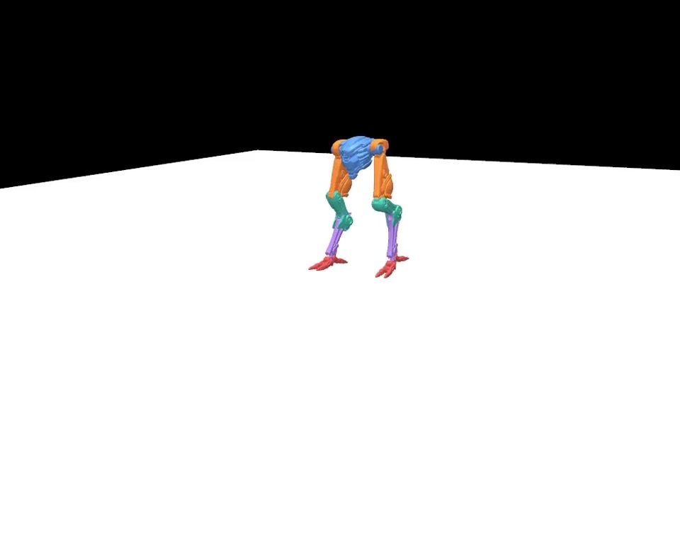

# Bipedal Robot Locomotion with MJWarp + PPO

GPU-vectorized reinforcement learning for a custom segmented biped robot. This
project combines MuJoCo Warp with a compact PyTorch PPO implementation and a
staged checkpoint curriculum to learn standing, forward walking, stable foot
contact, and left/right gait-balance refinement.

[](demo_trim.mp4)

> Click the preview to watch the 8-second, muted H.264 demo, or open
> [`demo_trim.mp4`](demo_trim.mp4) directly.

## Highlights

- Batched GPU simulation with MuJoCo Warp (MJWarp).
- A self-contained PyTorch PPO actor-critic implementation.
- Gaussian residual joint-position actions converted to torque by a PD
  controller.
- Staged checkpoint training: stand, walk, stabilize contact, and refine gait
  symmetry.
- Reproducible model, mesh assets, and selected checkpoints included in the
  repository.

The actor and critic both use two hidden layers (`400 -> 300`) with ReLU
activations. Observations combine root state, joint state, previous action, gait
phase, and command features. PPO collects rollouts from many MJWarp worlds,
computes GAE advantages, and updates the clipped policy objective on the GPU.

## Repository Layout

```text
.
|-- training/                    # Current staged MJWarp/PyTorch trainers
|-- tools/                       # XML and MJWarp model viewer
|-- artifacts/                   # Checkpoints used by the documented path
|-- robot_segment/               # MuJoCo mesh assets
|-- assets/demo_preview.jpg      # README preview linked to the demo
|-- demo_trim.mp4                # Muted H.264 demo
|-- robot_segment_trainable.xml  # Trainable MuJoCo model
`-- requirements-mjwarp.txt      # Reproducible CUDA training environment
```

Only the active MJWarp/PyTorch training path is kept in `training/`. The older
Gymnasium/Stable-Baselines3 trainer and the unused stage-2 experiment are not
part of the repository.

## Tested Setup

- Windows, Python 3.12.4
- PyTorch 2.11.0 + CUDA 12.8
- MuJoCo 3.8.0
- MuJoCo Warp 3.8.0.1
- NumPy 2.4.4

An NVIDIA CUDA GPU is expected for training. Playback uses the same policy and
MuJoCo model and is launched from the repository root.

## Installation

```powershell
py -3.12 -m venv .venv
.\.venv\Scripts\Activate.ps1
python -m pip install --upgrade pip
python -m pip install -r requirements-mjwarp.txt
```

Confirm that PyTorch can see CUDA:

```powershell
python -c "import torch; print(torch.cuda.is_available(), torch.version.cuda)"
```

## Quick Playback

The final balanced checkpoint is included. From the repository root, run:

```powershell
.\.venv\Scripts\python.exe training\train_segment_runner_mjwarp_torch_ppo_walk_stage_7_balance_from_stage10.py `
  --mode play `
  --xml-file robot_segment_trainable.xml `
  --device cuda:0 `
  --model-path artifacts\mjwarp_walk_stage_10_balanced_refine\segment_runner_mjwarp.pt `
  --play-steps 100000
```

Inspect the robot model without loading a policy:

```powershell
.\.venv\Scripts\python.exe tools\mjwarp_model_playground.py `
  --xml-file robot_segment_trainable.xml `
  --mjwarp-check `
  --device cuda:0
```

Add `--run` to let the model simulate freely.

## Training Path

The historical stage numbers are retained because the saved checkpoints use
those run names. The current source path is:

| Step | Trainer | Initializes from | Purpose |
| --- | --- | --- | --- |
| 1 | `training/train_segment_runner_mjwarp_torch_ppo_stand.py` | scratch | Upright standing and two-foot support |
| 2 | `training/train_segment_runner_mjwarp_torch_ppo_walk_stage_1.py` | `mjwarp_stage1_stand` | Conservative slow walking |
| 3 | `training/train_segment_runner_mjwarp_torch_ppo_walk_stage_3.py` | `mjwarp_walk_stage_1` | Stronger forward progress; saved as the stage-5 baseline in the main run |
| 4 | `training/train_segment_runner_mjwarp_torch_ppo_walk_stage_6.py` | `mjwarp_walk_stage_5` | Wave-reference gait and stable contact timing |
| 5 | `training/train_segment_runner_mjwarp_torch_ppo_walk_stage_7.py` | `mjwarp_walk_stage_6` | Full-toe contact and reduced torso oscillation |
| 6 | stage-7 trainer, continued | `mjwarp_walk_stage_7` | Strong continued walking checkpoint (`mjwarp_walk_stage_10`) |
| 7 | `training/train_segment_runner_mjwarp_torch_ppo_walk_stage_7_balance_from_stage10.py` | `mjwarp_walk_stage_10` | Final left/right gait-balance refinement |

Start with standing:

```powershell
.\.venv\Scripts\python.exe training\train_segment_runner_mjwarp_torch_ppo_stand.py `
  --mode train --xml-file robot_segment_trainable.xml --device cuda:0 `
  --n-envs 256 --n-steps 256 --timesteps 2000000 `
  --output-dir artifacts\mjwarp_stage1_stand
```

Train the conservative walking stage:

```powershell
.\.venv\Scripts\python.exe training\train_segment_runner_mjwarp_torch_ppo_walk_stage_1.py `
  --mode train --xml-file robot_segment_trainable.xml --device cuda:0 `
  --init-checkpoint artifacts\mjwarp_stage1_stand\segment_runner_mjwarp.pt `
  --n-envs 256 --n-steps 256 --timesteps 3000000 `
  --output-dir artifacts\mjwarp_walk_stage_1
```

Build the forward-moving baseline. The output name intentionally matches the
checkpoint expected by the next stage:

```powershell
.\.venv\Scripts\python.exe training\train_segment_runner_mjwarp_torch_ppo_walk_stage_3.py `
  --mode train --xml-file robot_segment_trainable.xml --device cuda:0 `
  --init-checkpoint artifacts\mjwarp_walk_stage_1\segment_runner_mjwarp.pt `
  --n-envs 256 --n-steps 256 --timesteps 4000000 `
  --target-forward-speed 0.24 `
  --output-dir artifacts\mjwarp_walk_stage_5
```

Continue through stage 6 and stage 7 with their default initialization
checkpoints, then create the stage-10 continuation checkpoint by reusing the
stage-7 trainer:

```powershell
.\.venv\Scripts\python.exe training\train_segment_runner_mjwarp_torch_ppo_walk_stage_6.py `
  --mode train --xml-file robot_segment_trainable.xml --device cuda:0 `
  --init-checkpoint artifacts\mjwarp_walk_stage_5\segment_runner_mjwarp.pt `
  --output-dir artifacts\mjwarp_walk_stage_6

.\.venv\Scripts\python.exe training\train_segment_runner_mjwarp_torch_ppo_walk_stage_7.py `
  --mode train --xml-file robot_segment_trainable.xml --device cuda:0 `
  --init-checkpoint artifacts\mjwarp_walk_stage_6\segment_runner_mjwarp.pt `
  --output-dir artifacts\mjwarp_walk_stage_7

.\.venv\Scripts\python.exe training\train_segment_runner_mjwarp_torch_ppo_walk_stage_7.py `
  --mode train --xml-file robot_segment_trainable.xml --device cuda:0 `
  --init-checkpoint artifacts\mjwarp_walk_stage_7\segment_runner_mjwarp.pt `
  --target-forward-speed 0.10 --learning-rate 1.5e-4 `
  --output-dir artifacts\mjwarp_walk_stage_10
```

Finish with balance refinement:

```powershell
.\.venv\Scripts\python.exe training\train_segment_runner_mjwarp_torch_ppo_walk_stage_7_balance_from_stage10.py `
  --mode train --xml-file robot_segment_trainable.xml --device cuda:0 `
  --init-checkpoint artifacts\mjwarp_walk_stage_10\segment_runner_mjwarp.pt `
  --n-envs 256 --n-steps 256 --timesteps 6000000 `
  --output-dir artifacts\mjwarp_walk_stage_10_balanced_refine
```

Use `--resume` to continue from
`<output-dir>/segment_runner_mjwarp.pt`. Use `--init-checkpoint` when starting a
new stage with a prior policy while resetting the optimizer.

## Included Checkpoints

The repository keeps the checkpoints needed by the documented path:

- `mjwarp_stage1_stand`
- `mjwarp_walk_stage_1`
- `mjwarp_walk_stage_5`
- `mjwarp_walk_stage_6`
- `mjwarp_walk_stage_7`
- `mjwarp_walk_stage_10`
- `mjwarp_walk_stage_10_balanced_refine`

Smoke-test and abandoned experimental runs remain local and are excluded by
`.gitignore`.

## Notes

- Run commands from the repository root so the relative XML, mesh, and
  checkpoint paths resolve correctly.
- Training is headless; `--mode play` opens the MuJoCo viewer.
- The trainer prints reward, termination, velocity, gait, contact, symmetry,
  and simulation-throughput metrics directly to the terminal.
- `--disable-cuda-graph` is intended for debugging and normally reduces
  throughput.

## Acknowledgements

The project uses [MuJoCo](https://mujoco.org/) and
[MuJoCo Warp](https://github.com/google-deepmind/mujoco_warp). The
[MathWorks MSRA Walking Robot](https://github.com/mathworks/msra-walking-robot)
project and locomotion research papers were consulted as external references;
their source and PDFs are not redistributed in this repository.

## License

No open-source license has been selected for this project. Unless a license is
added, all rights are reserved by the repository owner.
